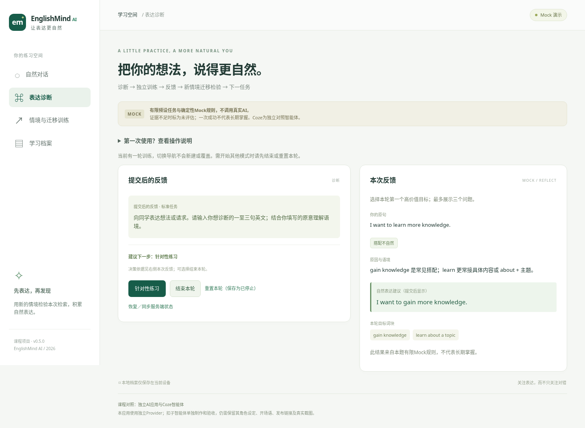
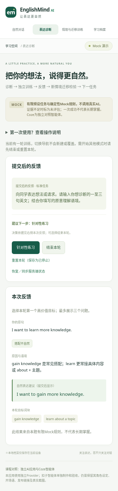

# EnglishMind AI v0.5.0

面向中国大学英语学习者的自然表达训练课程项目。React / TypeScript / Vite / Express / Zod 教学应用，保留 MockProvider、OpenAIProvider 与教学状态机，增加零 API 余额可用的独立 OllamaProvider。

**当前可以准备公开Mock演示，但尚未公开部署。本阶段未获收费测试授权，在线质量验收待执行，模型调用0次，未取得真实usage和账单。** Codex版与Coze版是独立对照项目，不把本应用改成Coze前端。


## 界面预览

以下为本地 Chromium 实际运行的 Mock 截图，仅展示预设案例，不代表真实模型验收或公开部署。





## 技术架构

```text
React / TypeScript / Vite
        │ 同源 HTTP，Cookie 会话隔离
Express API → 服务端教学状态机（历史、幂等、锁、取消、决策）
        │ Zod 校验的教学证据
        ├─ MockProvider：有限规则，默认模式
        ├─ OpenAIProvider：官方 SDK / Responses / 结构化输出
        └─ OllamaProvider：本机官方 /api/chat / 相同校验
浏览器 localStorage：最近100轮本地档案
```

`src/` 是前端，`shared/` 是契约，`server/` 是服务及 Provider，`quality/` 是 A–H 质量方案，`tests/` 与 `scripts/` 是离线验证/受控在线入口。模型不能修改真实练习历史。未来可增加 CozeProvider；本版 Coze 是独立对照智能体。

## 第一次体验

1. 在“表达诊断”开始一轮，使用示例 `I want to learn more knowledge.` 并提交。
2. 查看反馈后进入针对性练习，先独立表达再进入新情境迁移；需要时主动请求提示。
3. 结束本轮，在学习档案查看真实结果；清空已结束档案后刷新不会恢复。

Mock 仅支持预设案例，任意输入可能“未评估”。首页有可展开的使用说明。

## 运行

Node22.19+，验证环境24.19.0。保留 Git 历史和 v0.3.0、v0.4.0 检查点。代码仓库：[mashiro051105-hash/englishmind-ai](https://github.com/mashiro051105-hash/englishmind-ai)。

```bash
cd /workspace/englishmind-ai
npm ci --include=dev
npm run dev
```

运行机器访问localhost:5173，Vite保留原Host代理/API到3001，便于同源校验。生产先 `npm run build`，再 `npm start`，Express同源提供页面及API，访问运行机器3001。生产使用tsx启动，保留必要构建／运行依赖；不要仅上传dist到静态托管。已有.env请保留，模板没有真实密钥。

## 功能与教学原则

诊断 → 独立训练 → 提交后反馈 → 新情境迁移 → 下一任务。区分grammar、collocation、contextual_mismatch、acceptable_but_improvable、no_issue，最多三个高价值问题；正确表达不强行训练，证据不足可未评估。

AI评价支持分项：语言准确性、自然程度、任务信息完成度、目标词块检索证据。自然visit表达不自动等于go on a trip检索；正确词块但地点／时间错位可语言正确、任务失败。证据只引用学生原句；矛盾分类／维度拒绝并待人工确认。成功分类及提示／重试仍由服务器事件计算，模型不能改历史或长期掌握结论。

任务只公开中文情境；参考、目标和支架留在服务器，提示需要主动请求。复制已见表达不能仅凭重复算独立检索。完整三组演示见[演示案例](docs/demo-cases.md)，功能及课程对照说明见[课程演示](docs/course-demo.md)。

## 模式与费用开关

默认 `.env.example`：AI_PROVIDER=mock、ENABLE_PAID_AI=0，无费用模型调用。

真实Provider仍用服务端OPENAI_API_KEY与OPENAI_MODEL，但**仅配凭证不启用收费网页**。需要明确授权后另设ENABLE_PAID_AI=1和至少16字符AI_ACCESS_CODE。页面只输入演示访问码，不输入API Key；签名HttpOnly Cookie保存授权，码不放URL或localStorage。

无需 API 余额的本机方案：手动安装 Ollama、仅下载 `qwen3:4b`（约2.5GB Q4_K_M），使用 `.env.ollama.example` 切换 `AI_PROVIDER=ollama`。不自动下载、不访问OpenAI；当前未实机验证模型质量。Windows详细步骤、4060 8GB资源估计及模型切换见 [本地AI指南](docs/ollama-windows.md)。`npm run quality:local` 默认只打印 A–H 计划，手动 `RUN_LOCAL_AI=1` 才推理。

OpenAI真实在线测试是单独工具（目前余额为0，不执行、不要求充值）：

```bash
npm run quality:plan       # 只输出待执行计划，0模型请求
npm run test:live          # 同样使用授权门槛，不再绕过限制
```

获得用户明确授权并复核当天官方资料后，才使用.env.quality.example配置单独的.env.quality，并设置RUN_LIVE_AI=1、PAID_TEST_AUTHORIZED=yes、QUALITY_PREFLIGHT_CONFIRMED=yes。实际命令为 `DOTENV_CONFIG_PATH=.env.quality npm run quality:online`，不能由代理自行启用。候选Luna先测，Sol另行少量对照；不自动切换模型。

预算默认10次、最大12次，包含指定模型权限GET预检，通常8次生成／评价／总结调用；接口、额度、权限或模型响应错误立即停止后续案例；无自动重试，Ctrl+C可取消并保存部分报告。每次记录模型、延迟、状态、可得token及估价，不记密钥／真实学生完整输入。缺usage填null，估价不冒充账单。参考价及A–H人工准则见[质量评价文档](docs/ai-quality.md)。

## 安全与会话

所有浏览器有签名SameSite=Strict、HttpOnly Cookie；生产Secure。会话ID本身不能跨浏览器读写，开始键按浏览器命名空间隔离。API不开放跨源CORS，校验Origin和JSON内容类型。API响应no-store，生产CSP、HSTS等安全头；只服务dist，不暴露源码、.env或.git。

每IP默认120请求/分钟，每浏览器100；429有Retry-After。默认不信任X-Forwarded-For，单层可信代理可显式TRUST_PROXY_HOPS=1。收费调用默认每进程12次、每轮30次、每分钟20次，失败也计入。重启会重置这些本地上限，不替代账户费用预算。

原有revision、幂等、单轮异步锁和超时保留。增加明确取消操作，迟到响应不提交；失败可以安全重试，同键不能改参数。输入2000字符、原意500、HTTP16kb、输出1800token（可配置）及文本16000字符约束保留。

当前单进程内存会话，闲置24小时、部署／休眠／重启后失效。浏览器档案保留，未完成迁移不造成功；清空Cookie或换浏览器不能恢复原会话。只部署一个实例，APP_INSTANCES=1，不使用无状态serverless／多副本。本版不加数据库，不声称服务端持久化。

## 生产与部署

准备了render.yaml、Procfile、.node-version、.env.production.example及敏感文件排除规则。推荐Render Free单实例Mock课程演示；免费额度、休眠、临时文件系统、可能费用及完整操作见[部署文档](docs/deployment.md)。文件不会自动发布，不包含公开URL或API Key。

生产必须正确PUBLIC_ORIGIN（或Render的RENDER_EXTERNAL_URL）和至少32字符SESSION_COOKIE_SECRET。/api/health是免模型的存活检查；/api/ready配置不合法时503。二者都不验证线上模型能力。

## 检查

```bash
npm test
npm run typecheck
npm run build
npm run security:check
npm run test:browser       # 先启动npm run dev；系统Chromium
npm run test:restart       # 先构建；自启动3015并真实重启
npm run test:production    # 先构建；本地临时HTTPS，非公开部署
```

默认自动测试只用Mock或SDK模拟HTTP，不产生模型费用。在线入口不属于npm test。secret扫描和依赖审计是有限检查，不宣称完整安全审计。v0.5实际结果见[验收报告](docs/verification-v0.5.0.md)，v0.4历史见[verification.md](docs/verification.md)。

新增核心文件：server/security.ts（浏览器归属／门槛／限速）、shared/quality.ts（分项）、server/summary.ts（真实总结校验）、server/telemetry.ts（usage估价）、quality/cases.ts与runner.ts、scripts/quality-check.ts。原Provider、状态机、UI及测试均保留并扩展。

仍待完成：Windows Ollama真实推理与A–H人工复核，或未来有余额及授权后的OpenAI测试、实际托管访问验收、真实手机／Safari及屏幕阅读器；文本防泄露和提示词注入保护不是语义证明。没有长期教育效果数据，不能宣称模型已提高掌握程度。

## 归档与发布状态

版本历史见 [CHANGELOG](CHANGELOG.md)。`npm run archive` 从干净本地 Git 检查点导出 ZIP、SHA-256 及清单，排除依赖、真实配置和临时报告。ZIP 不含 Git 历史；可另做本地 Git bundle。

作者已创建并授权公开GitHub仓库；代码许可证尚未选择。Render 配置已准备，仍需作者连接账号、发布并核验实际 URL。具体步骤及 v1.0 关卡见 [归档发布说明](docs/archive-release.md)。本阶段没有收费请求或公开网站部署；GitHub推送及Release状态见验收报告。
